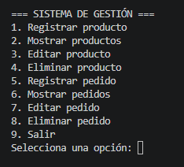
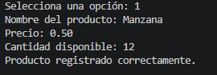
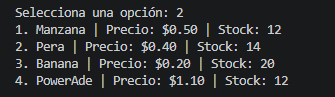
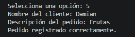
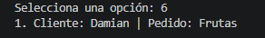

# Sistema de Gestión de Pedidos e Inventario

## Descripción

Programa desarrollado en Python para administrar productos y pedidos mediante un menú interactivo. Permite registrar, mostrar, editar y eliminar información.

## Funcionalidades

- Registrar productos con nombre, precio y stock.
- Mostrar el inventario actual.
- Editar y eliminar productos.
- Registrar pedidos con cliente y descripción.
- Mostrar, editar y eliminar pedidos.

## Tecnologías utilizadas

- Python 3.
- Listas y diccionarios.
- Funciones y procedimientos.
- Estructuras condicionales y ciclos.

## Evidencias de ejecución

Incluye capturas de pantalla del programa funcionando:

### Imagen 1. Menú principal

### Imagen 2. Registro y listado de productos

### Imagen 3. Registro y listado de pedidos

